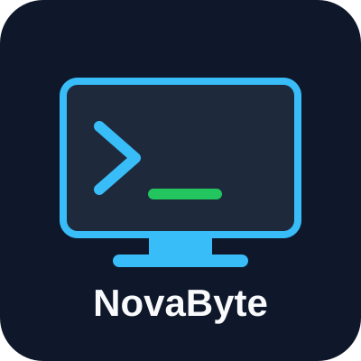

# NovaByte Consultoría Informática



**NovaByte** es una consultoría informática formada por estudiantes del ciclo *Sistemas Microinformáticos y Redes (SMR)*. Ofrecemos soluciones prácticas de sistemas, redes, seguridad y desarrollo web para pequeñas y medianas organizaciones, con un trato cercano y documentación clara de cada proyecto.

## Integrantes

- **Saba Burjanadze**
- **[Nombre y apellidos de tu compañero/a]**

> *"Tecnología que conecta tu negocio."*

---

## 1. Presentación de la consultora

| Dato | Información |
|------|-------------|
| **Nombre** | NovaByte Consultoría Informática |
| **Descripción** | Consultora *junior* especializada en sistemas, redes, seguridad y aplicaciones web |
| **Integrantes** | [Tu nombre] y [Nombre de tu compañero/a] |
| **Lema** | *Tecnología que conecta tu negocio* |

---

## 2. ¿Qué hacemos?

En NovaByte ofrecemos los siguientes servicios:

- Administración de sistemas (Linux y Windows Server).
- Diseño y configuración de redes.
- Seguridad informática.
- Desarrollo de aplicaciones web.
- Copias de seguridad.
- Mantenimiento informático.

---

## 3. Clientes con los que trabajamos

| Cliente | Sector | Necesidad tecnológica |
|---------|--------|-----------------------|
| TRIADA SPORT | Distribución deportiva | Infraestructura y servicios |
| HOTEL LEVANTE | Hostelería | Red y seguridad |
| EDUCA 21 | Educación | Usuarios y recursos |
| TECNOFÁBRICA | Industria | Redes y seguridad |
| COMERZIA | Comercio online | Aplicación web |

---

## 4. Elementos técnicos

**Datos de un servidor:**

```text
Servidor: srv-consultora
IP: 192.168.1.10
Red: 192.168.1.0/24
```

**Comando para actualizar un servidor Ubuntu:**

```bash
sudo apt update && sudo apt upgrade -y
```

**Fichero de configuración de Apache:**

```apache
<VirtualHost *:80>
    ServerName www.novabyte.local
    DocumentRoot /var/www/novabyte
</VirtualHost>
```

Ruta del fichero: `/etc/apache2/sites-available/novabyte.conf`

---

## 5. Enlaces de interés

- [Documentación de Linux](https://www.kernel.org/doc/html/latest/)
- [Documentación de Microsoft](https://learn.microsoft.com/es-es/)
- [Documentación de MDN](https://developer.mozilla.org/es/)
- [Documentación de Python](https://docs.python.org/es/3/)
- [Documentación de Wireshark (herramienta de redes)](https://www.wireshark.org/docs/)

---

## 6. Imagen o logotipo

Logotipo de NovaByte, creado por nosotros:


